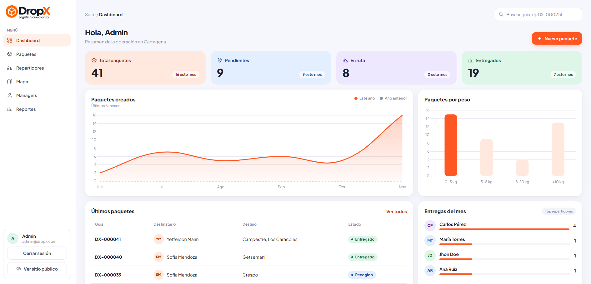
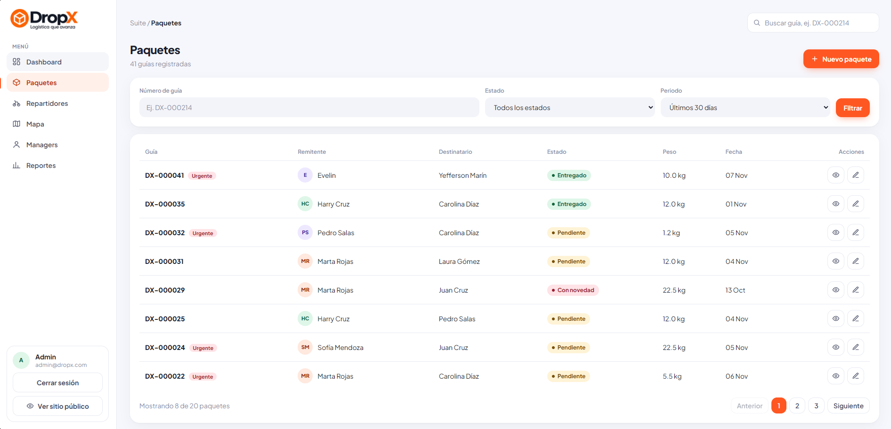
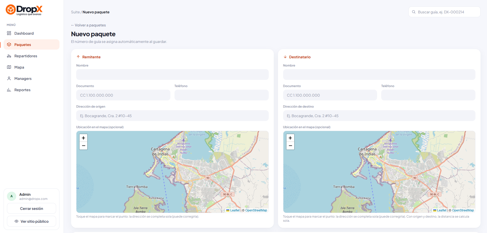
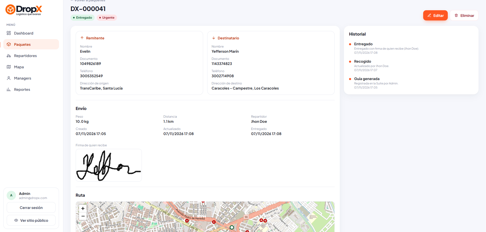
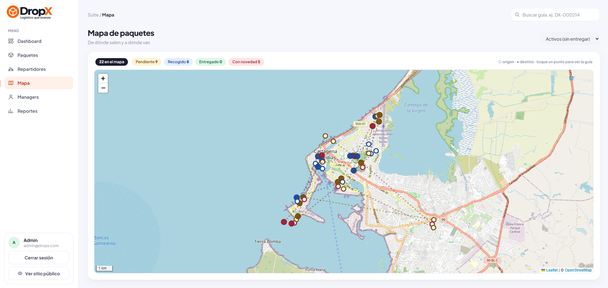
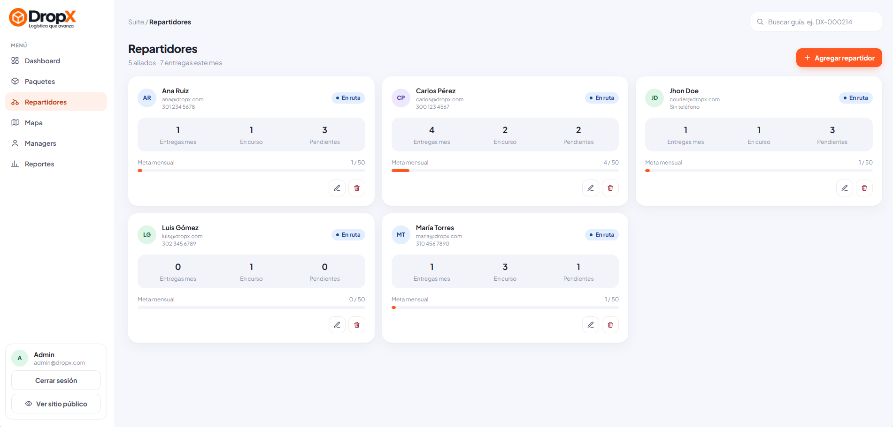
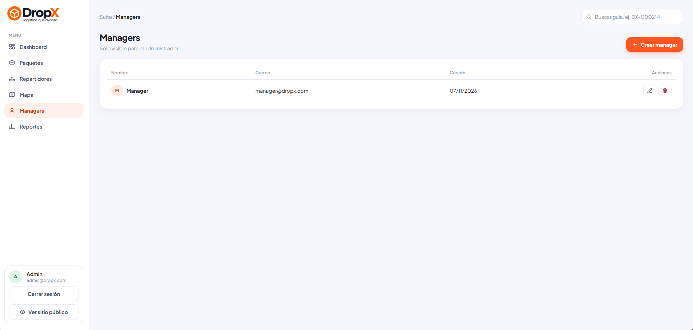
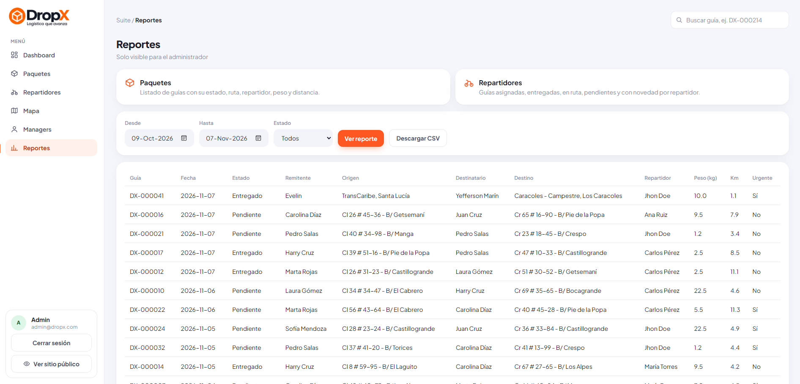

# DropX Web

Panel web, sitio público y API del proyecto DropX (mensajería y logística en Cartagena de Indias), desarrollados con Flask y MySQL.
La API es la que utiliza la app móvil [`dropx_app`](https://github.com/yammadev/dropx_app).

## Capturas

**Sitio público**

| Inicio | Rastreo | Ser aliado |
|---|---|---|
|  |  |  |

**Suite**

| Dashboard | Paquetes |
|---|---|
|  |  |
|  |  |
|  |  |
|  |  |

## Instalación y prueba

Requisitos: Python 3.10 o superior y MySQL encendido (en XAMPP, el módulo MySQL) con la base de datos `dropx` creada. No se necesita Node.

Terminal de VS Code, un comando por línea:

```bash
# Montar ambiente virtual e instalar requerimientos
python -m venv .venv
.\.venv\Scripts\Activate.ps1
pip install -r requirements.txt

# Copiar .env y generar llave aleatoria
cp .env.example .env
flask --app app key:generate
```

Cambiar en el `.env` los nombres (`SEED_*_NAME`) y las contraseñas (`SEED_*_PASSWORD`) y, luego, cargar los datos de prueba y encender el servidor:

```bash
# Datos de prueba y encender
flask --app app db:test
flask --app app run --debug
```

`db:test` reinicia la base de datos (pide confirmación) y crea los usuarios iniciales, 4 repartidores y 40 paquetes con su historial. Con `--packages 100` cambia la cantidad de paquetes.

El sitio queda en <http://127.0.0.1:5000> y la Suite en <http://127.0.0.1:5000/suite/login>. Las contraseñas son las definidas en el `.env`.

| Usuario | Correo | Rol |
|---|---|---|
| Administrador | `admin@dropx.com` | `admin` |
| Manager | `manager@dropx.com` | `manager` |
| Jhon Doe | `courier@dropx.com` | `courier` |
| Repartidores de prueba | `ana@dropx.com`, `carlos@dropx.com`, `luis@dropx.com`, `maria@dropx.com` | `courier` |

Qué revisar: como `admin` se ven todas las secciones, se puede eliminar y en Reportes se ven y descargan (CSV) los reportes de paquetes y de repartidores; como `manager` no aparecen Managers ni Reportes y no se puede eliminar; al crear un paquete se marcan el origen y el destino en el mapa, y la sección Mapa los muestra; el rastreo público se prueba en <http://127.0.0.1:5000/rastreo> con una guía como `DX-000001`; y la API con Postman, como se explica en [docs/api.md](docs/api.md).

### Comandos

| Comando | Qué hace |
|---|---|
| `flask --app app db:test` | Reinicia la base de datos y crea datos de prueba (solo desarrollo) |
| `flask --app app db:fresh` | Reinicia la base de datos y crea solo los usuarios iniciales (solo desarrollo) |
| `flask --app app db:upgrade` | Crea o actualiza las tablas (aplica las migraciones) |
| `flask --app app db:seed` | Crea los usuarios iniciales (los que ya existen se omiten) |
| `flask --app app db:migrate -m "descripcion"` | Genera una migración nueva al cambiar los modelos |
| `flask --app app key:generate` | Crea la `SECRET_KEY` en el `.env` |

Al cambiar la `SECRET_KEY` se cierran las sesiones y los tokens vigentes.

### Cambiar el diseño (opcional, requiere Node.js)

El CSS (`tailwind.css`), Chart.js y Leaflet ya están generados en el repositorio. Solo si se cambian las clases de las plantillas o los colores de `app/static/css/input.css`, se vuelven a generar:

```bash
npm install
npm run build
```

Mientras se diseña, `npm run css:watch` regenera el CSS al guardar cada cambio.

## Descripción

Toda la operación está limitada a Cartagena de Indias.

- **Sitio público:** landing (hero con video institucional, servicios, proceso, nosotros, Suite y contacto por WhatsApp), rastreo de guías (sin datos personales), ser aliado (por WhatsApp), privacidad y términos.
- **Suite (`/suite`):** panel para `admin` y `manager`: dashboard, paquetes (crear, filtrar, ver detalle y editar; solo el `admin` elimina), repartidores (crear y editar; solo el `admin` elimina), perfil propio (datos y contraseña) y, solo para `admin`: managers (crear, editar y eliminar) y reportes (solo interfaz).
- **API (`/api`):** autenticación con JWT para la app móvil.

| Rol | Qué hace | Desde dónde ingresa |
|---|---|---|
| `admin` | Administra el sistema (managers y reportes) | Suite |
| `manager` | Crea y edita paquetes y repartidores (no elimina) | Suite |
| `courier` | Reparte los paquetes | App móvil |

Estados de una guía: **Pendiente**, **Recogido**, **Entregado** y **Con novedad**.
El número de guía se asigna automáticamente al crear el paquete: el siguiente disponible, con el formato `DX-000001`.

## API

Autenticación con JWT para la app móvil. Las rutas están documentadas en [docs/api.md](docs/api.md).

## Variables de entorno (`.env`)

| Variable | Descripción |
|---|---|
| `SECRET_KEY` | Firma la sesión del panel y los tokens JWT. Obligatoria. |
| `DB_HOST`, `DB_PORT`, `DB_USER`, `DB_PASSWORD`, `DB_NAME` | Conexión a MySQL (por defecto, XAMPP local: `localhost`, `3306`, `root`, sin contraseña y `dropx`). |
| `DB_SSL_CA` | Opcional. Ruta del certificado `.pem` para servicios en la nube que exigen SSL (ej: Aiven). |
| `JWT_EXPIRES_HOURS` | Duración del token de la API (por defecto, 168 horas = 7 días). |
| `WHATSAPP_ADVISOR_NUMBER` | Número del asesor para el formulario de contacto. |
| `SEED_*_NAME`, `SEED_*_PASSWORD` | Nombres y contraseñas de los usuarios que crea `db:seed` (admin, manager y courier). |

## Arquitectura

- **`app/models.py`:** tablas `users`, `packages` y `package_events` (SQLAlchemy).
- **`app/suite.py`, `app/public.py`, `app/api.py`:** rutas del panel, del sitio y de la API (un `Blueprint` por archivo).
- **`app/commands.py`:** comandos `db:seed`, `db:test`, `db:fresh`, `db:upgrade`, `db:migrate` y `key:generate`.
- **Diseño:** [Tailwind CSS](https://tailwindcss.com) v4: las clases van directamente en las plantillas, y los colores y la tipografía de la marca están en `app/static/css/input.css`. Las clases que se repiten (botones, tarjetas, campos) están en `app/templates/_ui.html` y los componentes en `_macros.html`. Iconos SVG, gráficas con Chart.js (copiado a `static/js/vendor/`) y mapas con [Leaflet](https://leafletjs.com) y OpenStreetMap (copiado a `static/vendor/leaflet/`), ambos instalados con npm. Diseño claro, sin modo oscuro. La imagen del hero es una foto local (`static/img/hero-bodega.jpg`), por lo que no depende de internet.
- **Librerías:** Flask-SQLAlchemy y Flask-Migrate (base de datos y migraciones), Flask-Login (sesión del panel), Flask-JWT-Extended (API) y Flask-WTF (protección CSRF de los formularios).

## Estructura de carpetas

```
dropx_web/
├── app/
│   ├── __init__.py       # Crea la app y conecta las extensiones
│   ├── models.py         # Tablas: users, packages y package_events
│   ├── public.py         # Rutas del sitio público
│   ├── suite.py          # Rutas del panel web (login, paquetes, repartidores, managers)
│   ├── api.py            # Rutas de la API (login, paquetes y cambio de estado)
│   ├── commands.py       # Comandos: db:seed, db:test, db:fresh, db:upgrade, db:migrate y key:generate
│   ├── templates/
│   │   ├── public/       # Páginas del sitio (base.html es el diseño común)
│   │   └── suite/        # Páginas del panel (base.html es el diseño común)
│   └── static/
│       ├── css/          # input.css (colores y medidas de Tailwind) y tailwind.css (generado)
│       ├── js/           # site.js (menú y video), suite.js (menú, ventanas), dashboard.js (gráficas), maps.js (mapas) y vendor/chart.umd.js
│       ├── vendor/       # leaflet/ (librería de mapas)
│       └── img/          # Logos, video y foto del hero
├── package.json          # Comandos de npm (Tailwind, Chart.js y Leaflet)
├── docs/
│   └── api.md            # Rutas de la API
├── migrations/           # Migraciones de la base de datos (Flask-Migrate)
├── config.py             # Configuración (lee el .env)
├── requirements.txt      # Dependencias de Python
├── .env.example          # Modelo del .env (el .env real no se sube a GitHub)
├── .gitignore
└── README.md             # Documentación
```

Al cambiar los modelos, generar una nueva migración y aplicarla:

```bash
flask --app app db:migrate -m "descripcion del cambio"
flask --app app db:upgrade
```
